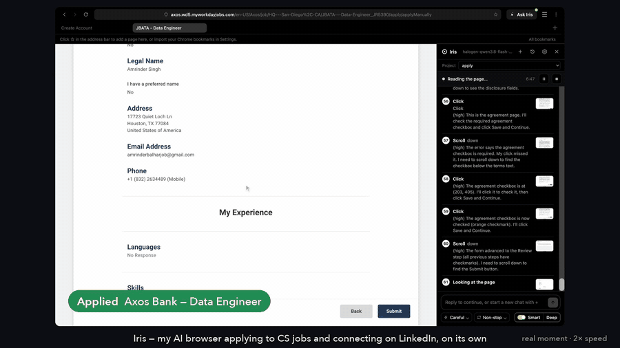
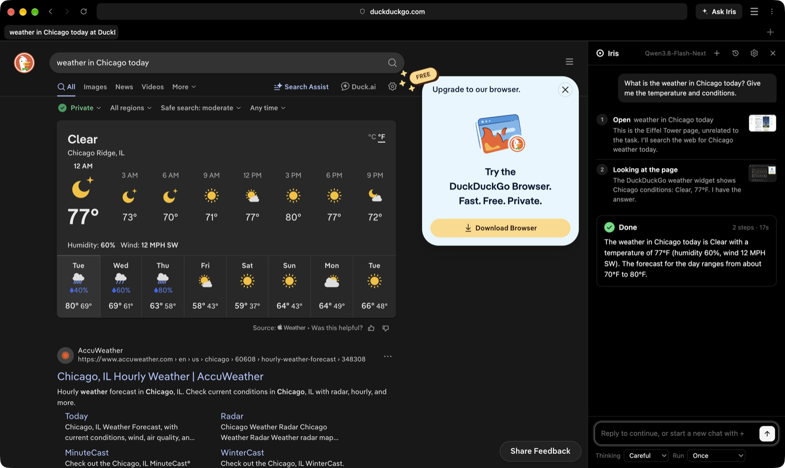
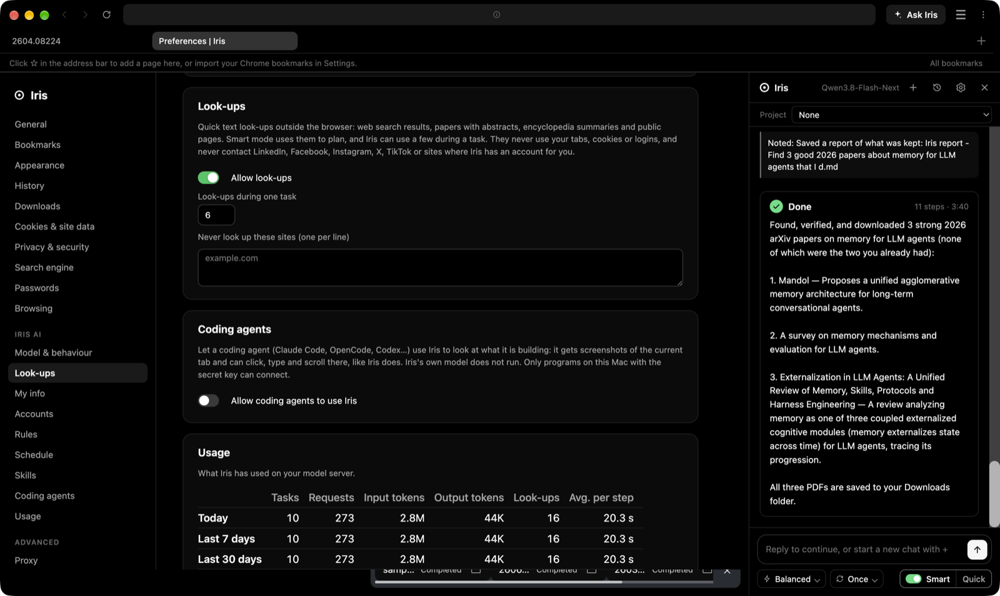

# Iris

**Iris is an agentic web browser for macOS.** You can use it as a normal browser, and when
something is tedious you describe the outcome you want and Iris drives the page for you —
step by step, in a side panel you can watch, pause, or take over at any time.

Iris is built on [Min](https://github.com/minbrowser/min) (Apache-2.0), which provides tabs,
tasks, history, bookmarks, search, content blocking and settings. Everything above that layer —
the visual identity, the agent, the panel, the safety gates — is new.

## See it run

[](docs/media/iris-highlights.mp4)

One evening's run, hands off: Iris finds computer-science jobs, fills in and submits each application, then sends
LinkedIn connection requests to people at that company. Real moments at 2× speed —
[watch the full 1-minute video](docs/media/iris-highlights.mp4).



---

## Quick start

### Run from source (development)

```bash
# Node 22 is required to install dependencies (Node 20 breaks @electron/get's ESM install)
export PATH=~/.nvm/versions/node/v22.19.0/bin:$PATH

npm install
npm run build
npx electron . --development-mode
```

### Run the packaged app

```bash
npm run buildMacArm           # -> dist/app/mac-arm64/Iris.app  (+ dist/app/iris-v<version>-mac-arm64.zip)
open dist/app/mac-arm64/Iris.app     # or drag it into /Applications and launch from the Dock
```

The package is ad-hoc signed (`codesign -s -`), which is fine for your own machine. It is not
notarised, so if you copy it to another Mac, allow it once in *System Settings → Privacy &
Security*.

### Watch the agent work without a model server

Iris ships a scripted model so the whole pipeline can be exercised offline:

```bash
IRIS_FAKE_MODEL=1 IRIS_AUTODEMO=1 IRIS_AGENT_DEBUG=/tmp/iris-agent.log \
  npx electron . --development-mode
```

`IRIS_FAKE_MODEL=1` swaps the HTTP client for `iris/agent/fakeModel.js`, which performs the same
`observe → think → act` conversation a real vision model would have. `IRIS_AUTODEMO=1` starts a
demo task ("click the middle of the page, scroll down, then stop") on launch so you can see the
timeline without typing. The real model server is never contacted by any test.

---

## Using Iris

| What | How |
| --- | --- |
| Open the Iris panel | `⌘⇧Space`, or the **Ask Iris** button |
| Run a task | Type what you want and press Enter |
| Continue the chat | Reply after a run ends; Iris keeps the context. **+** starts a new chat |
| Past chats | The clock button: reopen any saved chat and continue it |
| Projects | Chats in a project share one plan, notes, decisions and downloads |
| Pause / resume / stop | Buttons in the status bar while Iris works |
| Take over | Click or type in the page; Iris pauses. Type a message to tell it something, or press ▶ |
| Iris asks you | For a CAPTCHA, a phone code or a missing detail, Iris pauses, asks, and shows a macOS notification if you are away |
| Thinking | **Fast** (no thinking) · **Balanced** · **Careful** · **Deep** |
| Run | **Once** · **Non-stop** (no step or time limit, resumes itself after errors) · **Every 15 min … every day** |
| Smart | Off, **Quick** or **Deep** — see below |

Each step shows what Iris did, why, and the screenshot it decided from (click the thumbnail).


### Smart mode

For loose requests ("find me 10 good papers on …", "3 remote junior frontend jobs"), switch on
**Smart**. Before the first click Iris:

1. asks up to four multiple-choice questions if the request could mean different things;
2. **looks things up** outside the browser — web search results, papers with abstracts and citation
   counts (OpenAlex, arXiv), encyclopedia summaries — to learn where to go and what good looks like;
3. writes a short plan: goal, what a good result is, where to start, how, and when it is done.

During the run it opens each candidate, records a **keep / skip** judgement with a reason, repeats
the goal on every step, checks its progress against the plan every 15–20 steps, and never reports
something it did not see. **Quick** plans in seconds; **Deep** researches first (more look-ups, how
other people did it) and gets twice the steps and time.

### What Iris can do

Iris works like a person: it looks at a screenshot of the tab and uses the mouse and keyboard.
It never runs scripts inside the sites you visit.

- **Pages:** click, double-click, hover, drag, scroll, type (replaces the field's text), keys,
  ⌘A/C/V/X/Z, find on page (⌘F), zoom into a small area before clicking
- **Several actions per step:** fill a whole form in one go
- **Tabs:** follows links that open new tabs, closes ad pop-ups, switches, opens and closes tabs
- **Things a browser draws outside the page:** dropdowns are drawn inside the page so Iris can see
  them; alert / confirm / prompt dialogs and the file picker are answered like a person would
- **Downloads** go straight to `~/Downloads` (duplicates are skipped); **uploads** pick from your
  recent files; in the PDF viewer Iris knows where the download button is
- **Accounts:** logs in with **My info**, or signs up when you allow it; with permission it opens
  your inbox to read a verification code; every account it creates is listed in Settings with its
  link and why it was made
- **Look-ups:** quick text look-ups outside the browser (a few per task) to find where to go or to
  read a long public list in one step. They never use your cookies or logins and never contact
  LinkedIn, Facebook, Instagram, X, TikTok, or sites where Iris has an account for you
- **Memory:** notes, downloads and every keep/skip judgement survive long runs and new chats. A page
  or search result Iris judged before is flagged, so research never re-reads the same paper. Each
  step also lists the sites already tried, so Iris does not walk back into a dead end
- **Skills:** shortcuts it learns per site, plans that worked for a kind of task, and skills you
  write yourself ("when the task mentions flights, prefer direct trips")
- **Bookmarks:** a Chrome-style bookmarks bar, import from Chrome; Iris can bookmark pages, look
  bookmarks up and remove them
- **Payments:** Iris has no card. It goes as far as the payment page and tells you what is ready
- **Jobs:** finds postings that match your career profile, makes a one-page resume for each job
  from your own LaTeX template, applies, and keeps a list of every job applied to, skipped, or left
  for you (see below)

### Jobs: a resume tailored to every job

Put everything you have done in **Settings → Jobs → Career profile** — every skill, job, bullet,
project — far more than fits on a page (or start from your LaTeX resume: Iris reads it in). Then
ask Iris to "apply to jobs for me" (Non-stop keeps it going) or press **Start** under **Applying**.

For each posting Iris reads the requirements and calls `tailor_resume`: the model picks the
bullets, projects and skills that prove what the job asks for, best first, and may reword a
bullet toward the job's words. Code then checks every pick: only items from your profile, and a
rewording that adds a number, a tool or a new claim is undone. The result is built with your own
LaTeX template (or the built-in one) and made **exactly one full page** — Iris builds it, measures
how full the page is, and cuts or adds bullets until it fits. Jobs below your fit cutoff are
skipped; anything only you can do (a CAPTCHA that stays, a missing file) is marked **Needs you**
and Iris moves on. Tailored PDFs are kept in `~/Documents/Iris Resumes/<date> <company> - <job>/`.
For Greenhouse, Lever and Ashby postings the tailoring also gets the posting's own text from its link
(read outside the browser; never LinkedIn or a site you have an account on). The fit drops when a
posting asks for more years than your job dates show; "how many years with X" is answered from the
jobs that mention X; answers you give on a form are saved for the next one; every job ends up in
**Settings → Jobs → Applications** (applied, skipped, needs you).
LaTeX must be installed (MacTeX). How each part works: [docs/TECHNIQUES.md](docs/TECHNIQUES.md).

### Use Iris from a coding agent (MCP)

Turn on **Settings → Iris AI → Coding agents** and add the snippet it shows to your coding agent's
MCP servers. Your agent (Claude Code, OpenCode, Codex, …) can then take screenshots of the current
tab and click, type, scroll, navigate and manage tabs in Iris — handy for checking the web app it is
building. Iris's own model does not run. The bridge listens on `127.0.0.1` only and needs a secret
key stored in a file only you can read.

```json
{ "mcpServers": { "iris": { "command": "node", "args": ["/Users/<you>/Library/Application Support/Iris/iris-mcp.js"] } } }
```

Settings shows the exact snippet with your path; **Copy** puts it on the clipboard. With Claude Code
you can also run `claude mcp add iris -- node "/Users/<you>/Library/Application Support/Iris/iris-mcp.js"`.

30 tools. **Page:** `iris_screenshot`, `iris_click`, `iris_type`, `iris_key`, `iris_scroll`, `iris_hover`,
`iris_drag`, `iris_navigate`, `iris_back`, `iris_find`, `iris_wait`, `iris_zoom`, `iris_dialog`, `iris_upload`.
**Tabs:** `iris_tabs`, `iris_new_tab`, `iris_switch_tab`, `iris_close_tab`. **Iris's own tools:** `iris_lookup`,
`iris_bookmarks`, `iris_bookmark`, `iris_my_info` (secrets only as placeholders such as `{{Password}}`,
typed by Iris), `iris_accounts` (`{{account:site.com}}`), `iris_save_account`, `iris_downloads`,
`iris_career`, `iris_resume` (a one-page PDF from your agent's own picks), `iris_cover_letter`, `iris_applications`,
`iris_log_application`. Every page action returns a fresh screenshot unless you pass `"look": false`.

### Settings

- **General, Bookmarks, History, Cookies & site data, Appearance, Privacy, Search engine,
  Passwords, Browsing** — the usual browser settings
- **Iris AI:** the model provider, then its server, model and API key, thinking level, Smart
  default, steps and minutes per task, screenshot size, when a site needs an account. Providers:
  - **Local model** — any OpenAI-compatible server you run (llama.cpp, LM Studio, Ollama, Lemonade);
    nothing leaves your network
  - **OpenAI-compatible API** — OpenAI, OpenRouter, Groq or any `/v1/chat/completions` endpoint, with your key
  - **Claude** — the Anthropic Messages API (`/v1/messages`), with your key

  Each provider keeps its own URL, model and key, so switching back and forth loses nothing. Test
  connection asks the server for its models (from the app, so cloud APIs work too) and offers them
  in the Model field. The model has to read images: Iris works from screenshots.
- **Look-ups:** on/off, how many per task, sites never to contact
- **My info:** your details for forms and logins. Secret fields are encrypted with the macOS
  keychain and never shown to the model: it types `{{Password}}` and Iris fills in the real value
- **Accounts, Rules, Schedule, Skills, Coding agents, Usage** (tasks, requests, tokens, look-ups,
  time per step — today, 7 and 30 days, all time; then tokens and output speed per project and for
  the last sessions). While a task runs, the panel's status line shows the model's speed
  (`61 tok/s`), the context of its last reply (`ctx 7.5k`) and what the session has used so far;
  the result card adds the run's tokens
- **Jobs:** Career profile, Applying (roles, places, fit needed, submit on its own or ask first,
  per-day limit, answers for application forms), Resume template (built-in or your LaTeX, try it),
  Applications



---

## How the agent works

Iris is deliberately **vision-only**. The model gets screenshots and nothing else; actions are
real input events (`webContents.sendInputEvent`), not DOM calls.

```
                 ┌──────────────────────────────────────────────┐
                 │                  agent loop                  │
  task ────────▶ │  0. SMART     questions → look-ups → plan     │
                 │  1. OBSERVE   screenshot + page state         │
                 │  2. THINK     model call (vision in, JSON out)│
                 │  3. ACT       strict parse → input events     │
                 │  4. VERIFY    did the page change?            │
                 └──────────────────────────────────────────────┘
                          │            │            │
                     safety gate   pointer overlay  timeline → panel
```

**See.** `webContents.capturePage()` of the tab (retried, blank pages detected), downscaled to the
configured longest edge, JPEG. Only the newest screenshot stays in the conversation.

**Think.** One streamed request per step (`chat/completions`, or `messages` for Claude): the screenshot, URL,
title, tabs, the plan's goal, a digest of older steps, sites already tried, notes and decisions.
Everything but the newest step stays byte-identical so the server's prompt cache keeps working;
old steps are summarised in chunks.

**Act.** Model output is parsed against a strict action grammar (`actionSchema.js`) with a
recovery parser for sloppy JSON. Each action becomes real mouse/keyboard events (`inputPlan.js`)
with an eased pointer glide. Coordinates are mapped from image pixels to view pixels per axis
(`coordinateMapper.js`), so Retina and downscaled screenshots line up.

**Stop conditions.** `safety.js`: step and time budgets (none in Non-stop), model timeout, retries,
consecutive failures, repeated actions on a frozen page, and the payment guard.

**Aim.** Before a click Iris reads the pointer's shape at that spot (hand over links and buttons,
I-beam over fields); a click that lands on the plain arrow moves onto the nearest hand or I-beam within
10 px — never for checkboxes, radios or dropdowns. A click that changed nothing is marked with a red ✕
on the next screenshot.

**One model call at a time.** A lock file per model server makes a second Iris window wait its turn,
so a local server never gets two requests at once.

**Takeover.** Input injected by Iris is timestamped; any real input in the page outside that
window pauses the run instead of fighting you.

Every technique, with before/after numbers: [docs/TECHNIQUES.md](docs/TECHNIQUES.md).

---

## Layout of the code

| Path | What it is |
| --- | --- |
| `iris/agent/agentLoop.js` | Smart planning, observe → think → act → verify, pause/stop/resume, budgets |
| `iris/agent/actionSchema.js` | Action grammar + recovery parser, the rules the model gets |
| `iris/agent/history.js` | What the model sees each step: chunked compaction, digest, notes, sites, plan |
| `iris/agent/prompts.js` | Every text said to the model |
| `iris/agent/lookup.js` | Look-ups outside the browser: search, papers, arXiv, Wikipedia, public pages |
| `iris/agent/career.js` | Jobs: career profile, LaTeX templates and import, tailoring checks, one-page fitting |
| `iris/agent/modelLock.js` | One model request at a time across Iris windows |
| `iris/agent/memory.js` | Memory beyond the context window: identifiers, duplicate checks, recall |
| `iris/agent/safety.js` | Stop conditions and the payment guard |
| `iris/agent/inputPlan.js` | Actions → native mouse/keyboard event sequences |
| `iris/agent/coordinateMapper.js` | Image px ⇄ view CSS px |
| `iris/agent/modelClient.js` | Streaming model client: OpenAI-style and Claude Messages API, thinking levels, abort |
| `iris/agent/usage.js` | Token use per day, session and project, and output speed |
| `main/irisAgent.js` | The Electron side: the "computer", tabs, downloads, sessions, projects, accounts, skills |
| `main/irisJobs.js` | Jobs on the Electron side: storage, LaTeX builds, tailoring, applications log |
| `main/irisBridge.js`, `bin/iris-mcp.js` | Coding-agent bridge and its MCP server |
| `js/iris/agentPanel.js` | The side panel |
| `js/iris/bookmarksBar.js` | Bookmarks bar, star, Chrome import |
| `pages/settings/` | Settings (`jobs.js`: the Jobs sections) |
| `test/*.test.js` | Unit tests for the Electron-free core |

---

## Tests

```bash
node --test test/*.test.js      # no Electron, no network, a few seconds
```

Covered: the action grammar, coordinate mapping, every safety stop, input planning, the model
client (both wire formats, against a local mock server too), usage tracking, memory and duplicate detection, look-up parsers, Chrome bookmark import, the MCP server,
the Jobs core (LaTeX import of a Jake-style resume, template rendering, tailoring checks, one-page
fitting), the cross-window model lock, and
the loop itself (Smart planning with look-ups, quizzes, judging, compaction, budgets, pause, stop,
takeover). No test talks to a real model server.

---

## Branding and attribution

Iris has its own look: a plain white interface with a black dark mode, its own icon
(`icons/source/iris.svg`, rasterised by `scripts/renderIcon.js`), a compact two-row toolbar with a
bookmarks bar, and its own panel and settings. Min's `LICENSE`, copyright notices and attribution
remain in place.

## Known limitations

See [REPORT.md](REPORT.md) for the honest status list: what is verified on a real Mac, what is
verified only by unit tests (because it needs a real vision model), and what is queued next.

## License

Apache-2.0, same as Min. See `LICENSE` and `docs/UPSTREAM.md`.
